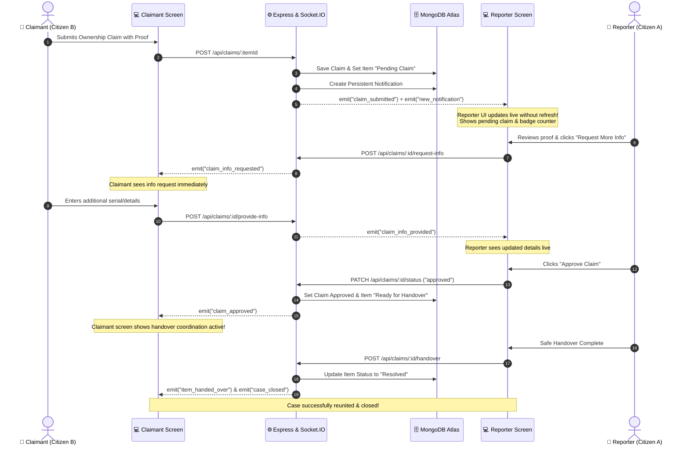
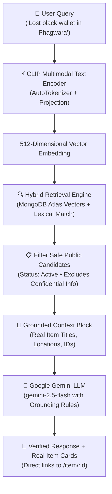
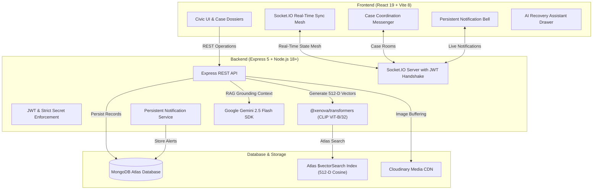

<div align="center">

# 🧭 HavenFind — Civic Lost & Found Recovery Network

<p align="center">
  <b>Modern full-stack civic lost-and-found recovery network powered by Multimodal AI Visual Search, Grounded RAG, Real-Time Application Synchronization, and Case-Based Direct Coordination.</b>
</p>

[](https://react.dev/)
[](https://vitejs.dev/)
[](https://nodejs.org/)
[](https://expressjs.com/)
[](https://www.mongodb.com/products/platform/atlas-vector-search)
[](https://socket.io/)
[](https://tailwindcss.com/)
[](tel:+918092982304)
[](LICENSE)

<br />

[Explore Features](#-key-features) • [What is RAG?](#-what-is-rag--how-is-it-used-in-havenfind) • [Real-Time Synchronization](#-complete-real-time-application-synchronization) • [Case Management](#-civic-case-detail--8-stage-recovery-lifecycle) • [Architecture](#-architecture) • [Getting Started](#-getting-started) • [Atlas Vector Search](#-mongodb-atlas-vector-search-setup) • [API Reference](#-api-endpoints)

</div>

---

## 📖 Overview

**HavenFind** is a production-grade, full-stack civic lost-and-found recovery platform designed to modernize how lost property is reported, visually matched, claimed, and recovered. Unlike legacy bulletin boards that rely purely on ambiguous text keywords, **HavenFind** combines **local Vision-Language AI embeddings (`CLIP ViT-B/32`)**, **zero-reload Socket.IO application synchronization**, **grounded Gemini RAG assistance**, and **secure direct citizen-to-reporter coordination**.

### Core Highlights:
- **Multimodal Visual Search**: Upload an image to find similar lost or found items using **512-dimensional CLIP embeddings** and cosine vector similarity with automatic local fallback.
- **Zero-Reload Application Synchronization**: Submitting claims, reviewing proof, requesting info, approving handovers, and closing cases update all connected screens in real-time without refreshing.
- **Direct Citizen Coordination Channel**: Pre-claim inquiry ("Contact Reporter") before claiming, plus post-claim handover coordination with live claim status banners.
- **Persistent In-App Notifications**: MongoDB-persisted civic notification alerts with real-time socket delivery, unread counters, and audio/toast prompts.
- **Human-Centric Case Management**: 8-stage civic recovery status tracker with chronological verified milestones and private location masking.
- **24/7 Civic Helpline & Support**: One-tap telephone support (`+91 8092982304`) integrated across navigation, mobile menus, safe dispatch banners, and case dossiers.

---

## ✨ Key Features

| Feature | Description |
| :--- | :--- |
| 🔍 **Multimodal Visual Search** | Upload an image to find similar items via **512-D CLIP embeddings** (`Xenova/clip-vit-base-patch32`) matching across photo-to-photo and text-to-photo. |
| 🤖 **Grounded RAG Recovery Assistant** | Natural language civic inquiry powered by **hybrid CLIP vector retrieval + Google Gemini 2.5 Flash** returning grounded matches with direct `/item/:id` links. |
| ⚡ **Zero-Reload Real-Time Synchronization** | Complete reactive state synchronization across the entire platform via **Socket.IO** (claims, reviews, approvals, rejections, handovers, and case closures update instantly). |
| 💬 **Case-Based Direct Coordination** | In-app messenger supporting **pre-claim inquiries** ("Contact Reporter") without submitting claims, and post-claim handover coordination. |
| 🔔 **Persistent MongoDB Notifications** | Real-time notification pipeline with MongoDB persistence, unread counters, mark-as-read actions, and instant live toast alerts. |
| 🛡️ **Civic Ownership Verification** | Structured claim review workspace for reporters with private proof inspection, info requests, and single-click resolution. |
| 📍 **Civic Privacy Masking** | Prevents public exposure of sensitive private street addresses; displays only general municipal precincts or metropolitan areas. |
| 📞 **24/7 Customer Care & Helpline** | Quick-dial contact integration (`+91 8092982304`) embedded across desktop banners, mobile drawers, dispatch banners, and case cards. |
| 🔐 **Hardened Security & RBAC** | Strict environment-enforced JWT secrets (zero hardcoded fallbacks), object-level authorization, ReDoS-safe regex escaping, and rate limiting. |
| 🎨 **Civic Design System** | Accessible civic theme featuring **Plus Jakarta Sans**, **JetBrains Mono**, glassmorphic surfaces, **Tailwind CSS v4**, and **Sonner**. |

---

## ⚡ Complete Real-Time Application Synchronization

HavenFind does not require page reloads for any critical case action. A centralized Socket.IO event mesh synchronizes state instantaneously between citizens and reporters:



---

## 📋 Civic Case Detail & 8-Stage Recovery Lifecycle

HavenFind organizes every reported item into a transparent, human-readable case dossier.

### The 8 Civic Recovery Stages:
1. 🟡 **Lost – Waiting for a Match**: A citizen reported a lost item; the registry is actively cross-matching listings.
2. 🔵 **Found – Waiting for Owner**: A finder safely logged a found item; awaiting authentic claimant verification.
3. 🟠 **Claim Submitted**: A citizen submitted an ownership claim with identifying proof details.
4. 🟣 **Claim Under Review**: The reporter or municipal coordinator is examining proof or has requested clarifying details.
5. 🟢 **Claim Approved**: Ownership has been verified; parties are connected for safe return.
6. 🤝 **Ready for Handover**: Secure meeting place or municipal drop-off location has been established.
7. 🎉 **Successfully Reunited**: Handover completed and verified by the parties.
8. 🔒 **Case Closed**: Complete recovery lifecycle concluded and archived in the registry.

### Case Dossier Sections:
- **Case Overview**: High-resolution image preview, civic status badges, item metadata, general location (with private address masking), and quick-action buttons.
- **Recovery Progress Tracker**: Chronological timeline displaying verified milestones with real backend timestamps and audit history.
- **Ownership Verification Workspace**: Displays claim counts, confidential proof inspection for authorized reporters, info requests, and decision actions.
- **Direct Case Coordination Channel**: Integrated real-time messenger featuring pre-claim inquiry ("Contact Reporter") and post-claim handover coordination.
- **Civic Helpline Card**: Dedicated support callout (`+91 8092982304`) for citizen escalation.

---

## 🧠 What is RAG & How is it Used in HavenFind?

### What is RAG (Retrieval-Augmented Generation)?
**RAG (Retrieval-Augmented Generation)** is an advanced AI architecture that prevents Large Language Models (LLMs) like Google Gemini from hallucinating by grounding their answers in **real-time data retrieved from a live database**.

```text
User Question ➔ Live Database Search (Retrieves Real Records) ➔ Feeds Real Records into LLM ➔ 100% Grounded Answer
```

---

### What is RAG Used For in HavenFind?

In HavenFind, RAG powers the **AI Recovery Assistant** — an intelligent civic recovery agent that helps citizens locate lost property using everyday natural language (e.g., *"I lost my black leather wallet near Phagwara yesterday with a silver zipper"*).



#### Key Capabilities of HavenFind RAG:
1. **Zero Hallucinations**: If an item does not exist in MongoDB, Gemini responds truthfully: *"I searched the HavenFind Civic Registry, but found no active public reports matching your description."*
2. **Cross-Modal Shared Vector Space (`CLIP ViT-B/32`)**: Text queries and item photos map into the exact same 512-dimensional vector space.
3. **Strict Confidentiality Protection**: The retriever strictly excludes `confidentialVerification` fields so secret marks or serial numbers are never leaked.
4. **Actionable Civic Recovery Links**: Renders interactive cards with **"View Dossier"** buttons navigating directly to `/item/:id`.

---

## 🏗️ Architecture



For complete technical specifications, see [ARCHITECTURE.md](ARCHITECTURE.md).

---

## 🛠️ Tech Stack

### Frontend
- **Framework**: React 19 + Vite 8
- **Styling**: Tailwind CSS v4, Lucide React icons, Material Symbols Outlined
- **Typography**: Plus Jakarta Sans (UI) & JetBrains Mono (Data/Identifiers)
- **Animations & Effects**: Framer Motion, `react-parallax-tilt`
- **Real-Time Client**: Socket.IO Client with automatic room reconnection
- **Networking**: Centralized Axios API client (`src/services/api.js`)
- **Feedback & Toasts**: Sonner Toast Notifications

### Backend
- **Runtime & Server**: Node.js 18+ & Express 5.2
- **AI / Embeddings**: `@xenova/transformers` (`Xenova/clip-vit-base-patch32`) generating 512-D vectors
- **LLM / Generative AI**: Google Gemini 2.5 Flash (`@google/genai`)
- **Database & ODM**: MongoDB Atlas & Mongoose
- **Real-time Protocol**: Socket.IO 4.8 with authenticated JWT handshakes
- **Media Storage**: Cloudinary SDK & Multer (In-memory streaming)
- **Security**: Strict environment JWT validation, bcryptjs, ReDoS-safe regex escaping, sliding-window rate limiting

---

## 🚀 Getting Started

### Prerequisites
- [Node.js](https://nodejs.org/) (v18.x or later)
- [MongoDB Atlas](https://www.mongodb.com/cloud/atlas) cluster connection string
- [Cloudinary](https://cloudinary.com/) account for image storage
- [Google Gemini API Key](https://aistudio.google.com/) for Grounded RAG Assistant

---

### 1. Clone the Repository

```bash
git clone https://github.com/Vishal4256/lostandfound.git
cd lostandfound
```

---

### 2. Backend Configuration & Setup

1. Navigate to the `backend` directory:
   ```bash
   cd backend
   ```

2. Install dependencies:
   ```bash
   npm install
   ```

3. Configure your environment variables:
   Copy `.env.example` to `.env`:
   ```bash
   cp .env.example .env
   ```

   Fill in your credentials:
   ```env
   PORT=5000
   MONGO_URI=mongodb+srv://<username>:<password>@cluster0.mongodb.net/lost-and-found?retryWrites=true&w=majority
   JWT_SECRET=your_super_secret_jwt_key
   CLOUDINARY_CLOUD_NAME=your_cloudinary_cloud_name
   CLOUDINARY_API_KEY=your_cloudinary_api_key
   CLOUDINARY_API_SECRET=your_cloudinary_api_secret
   GEMINI_API_KEY=your_google_gemini_api_key
   ```

4. Start the backend development server:
   ```bash
   npm run dev
   ```
   > 💡 *Note: On first startup, the local CLIP ViT-B/32 ONNX model is automatically downloaded and cached in memory.*

---

### 3. Frontend Configuration & Setup

1. Open a new terminal and navigate to the `frontend` directory:
   ```bash
   cd frontend
   ```

2. Install dependencies:
   ```bash
   npm install
   ```

3. Configure frontend environment variables:
   Create `frontend/.env`:
   ```env
   VITE_API_URL=http://localhost:5000/api
   VITE_SOCKET_URL=http://localhost:5000
   ```

4. Start the frontend development server:
   ```bash
   npm run dev
   ```

5. Open your browser and navigate to:
   ```text
   http://localhost:5173
   ```

---

## 🗄️ MongoDB Atlas Vector Search Setup

To enable Atlas Vector Search for sub-second cosine visual matching:

1. In the **MongoDB Atlas Console**, navigate to your cluster and select **Search and Vector Search**.
2. Click **Create Search Index** ➔ Select **JSON Editor**.
3. Select your database (e.g., `lost-and-found`) and collection (`items`).
4. Set the **Index Name** to: `vector_index`.
5. Paste the following configuration:

```json
{
  "fields": [
    {
      "numDimensions": 512,
      "path": "embedding",
      "similarity": "cosine",
      "type": "vector"
    },
    {
      "path": "itemType",
      "type": "filter"
    },
    {
      "path": "status",
      "type": "filter"
    },
    {
      "path": "category",
      "type": "filter"
    }
  ]
}
```

6. Click **Create Search Index**.
*(Note: If the Atlas Vector Index is not yet provisioned, the backend automatically falls back to an exact in-memory cosine similarity engine seamlessly!)*

---

## 📡 API Endpoints

For comprehensive request/response payloads, refer to [API_DOCUMENTATION.md](API_DOCUMENTATION.md).

### 🔑 Authentication (`/api/auth`)
| Method | Endpoint | Description | Auth Required |
| :--- | :--- | :--- | :---: |
| `POST` | `/api/auth/register` | Register new user account | ❌ |
| `POST` | `/api/auth/login` | Sign in and receive JWT token | ❌ |
| `GET` | `/api/auth/me` | Fetch authenticated user profile | ✅ |

### 📦 Items & Visual Search (`/api/items`)
| Method | Endpoint | Description | Auth Required |
| :--- | :--- | :--- | :---: |
| `GET` | `/api/items` | Paginated search (category, itemType, status, search, mine) | ❌ / Optional |
| `GET` | `/api/items/:id` | Fetch complete item dossier | ❌ |
| `POST` | `/api/items` | Report lost/found item with image & 512-D CLIP embedding | ✅ |
| `POST` | `/api/items/search` | Search items visually by uploading an image | ❌ |
| `PATCH` | `/api/items/:id/status` | Update item status (`Active`, `Pending Claim`, `Resolved`) | ✅ |
| `DELETE`| `/api/items/:id` | Delete item dossier (Reporter or Admin only) | ✅ |

### 🛡️ Ownership Claims (`/api/claims`)
| Method | Endpoint | Description | Auth Required |
| :--- | :--- | :--- | :---: |
| `POST` | `/api/claims/:itemId` | Submit ownership claim with identifying proof | ✅ |
| `GET` | `/api/claims/my-claims` | Get all claims submitted by current user | ✅ |
| `GET` | `/api/claims/item/:itemId` | Get claims for an item (Reporter or Admin only) | ✅ |
| `PATCH` | `/api/claims/:id/resolve` | Approve or reject an ownership claim | ✅ |
| `POST` | `/api/claims/:id/request-info`| Reporter requests additional proof from claimant | ✅ |
| `POST` | `/api/claims/:id/provide-info`| Claimant submits requested clarifying proof | ✅ |
| `POST` | `/api/claims/:id/handover` | Confirm safe handover & mark item resolved | ✅ |

### 💬 Real-Time Chat & Coordination (`/api/chat`)
| Method | Endpoint | Description | Auth Required |
| :--- | :--- | :--- | :---: |
| `GET` | `/api/chat/conversations` | List user's active conversations | ✅ |
| `POST` | `/api/chat/conversations` | Get or create conversation (Pre-claim or Claim) | ✅ |
| `GET` | `/api/chat/conversations/:id/messages` | Fetch message history for a conversation | ✅ |
| `POST` | `/api/chat/conversations/:id/messages` | Send message into conversation room | ✅ |

### 🔔 Persistent Notifications (`/api/notifications`)
| Method | Endpoint | Description | Auth Required |
| :--- | :--- | :--- | :---: |
| `GET` | `/api/notifications` | Fetch user's persistent notifications & unread count | ✅ |
| `PATCH` | `/api/notifications/:id/read` | Mark a specific notification as read | ✅ |
| `PATCH` | `/api/notifications/read-all` | Mark all notifications as read | ✅ |

### 🤖 Grounded AI Recovery Assistant (`/api/ai`)
| Method | Endpoint | Description | Auth Required |
| :--- | :--- | :--- | :---: |
| `POST` | `/api/ai/recovery` | Natural language inquiry using hybrid CLIP retrieval + Gemini 2.5 Flash | ✅ |

---

## ⚡ Socket.IO Real-Time Mesh

| Event | Direction | Payload Description |
| :--- | :--- | :--- |
| `join_user_room` | Client ➔ Server | Joins user's private notification and synchronization room |
| `join_conversation` | Client ➔ Server | Joins secure item communication room |
| `new_message` | Server ➔ Client | Broadcasts new message to conversation participants |
| `claim_submitted` | Server ➔ Client | Emitted to reporter when a new ownership claim is submitted |
| `claim_reviewed` | Server ➔ Client | Emitted to claimant and case room when claim is updated |
| `claim_approved` | Server ➔ Client | Emitted when claim is approved, unlocking handover |
| `claim_rejected` | Server ➔ Client | Emitted when claim is rejected with reason |
| `claim_info_requested` | Server ➔ Client | Notifies claimant that additional verification details are required |
| `claim_info_provided` | Server ➔ Client | Notifies reporter that claimant submitted requested details |
| `item_handed_over` | Server ➔ Client | Broadcasts successful handover completion |
| `case_closed` | Server ➔ Client | Broadcasts case closure across all viewers |
| `new_notification` | Server ➔ Client | Pushes persistent notification directly to recipient's bell |

---

## 📁 Project Structure

```text
lostandfound/
├── backend/
│   ├── controllers/            # Route controllers
│   │   ├── authController.js
│   │   ├── chatController.js
│   │   ├── claimController.js
│   │   ├── itemController.js
│   │   ├── notificationController.js
│   │   └── ragController.js
│   ├── middleware/             # Security & handling middleware
│   │   ├── authMiddleware.js   # JWT authentication & role enforcement
│   │   ├── rateLimiter.js      # Sliding-window brute force protection
│   │   └── upload.js           # Multer in-memory upload filter
│   ├── models/                 # Mongoose schemas
│   │   ├── Claim.js
│   │   ├── Conversation.js
│   │   ├── Item.js
│   │   ├── Message.js
│   │   ├── Notification.js
│   │   └── User.js
│   ├── routes/                 # Express route routers
│   │   ├── authRoutes.js
│   │   ├── chatRoutes.js
│   │   ├── claimRoutes.js
│   │   ├── itemRoutes.js
│   │   ├── notificationRoutes.js
│   │   └── ragRoutes.js
│   ├── services/               # Background & AI services
│   │   ├── embeddingService.js # Local CLIP ViT-B/32 512-D vector extraction
│   │   ├── notificationService.js # Persistent DB & Socket notification dispatcher
│   │   └── ragService.js       # Grounded RAG with Google Gemini 2.5 Flash
│   ├── .env.example            # Backend environment template
│   ├── package.json            # Backend scripts & dependencies
│   └── server.js               # Express application & Socket.IO initialization
│
├── frontend/
│   ├── src/
│   │   ├── components/         # Reusable UI components
│   │   │   ├── common/         # StatCard, StatusBadge, ItemCard, EmptyState, ErrorBoundary
│   │   │   ├── layout/         # Navbar (with 24/7 Helpline & Bell), Footer, AppLayout
│   │   │   ├── AiRecoveryAssistant.jsx # Grounded RAG Drawer
│   │   │   ├── MatchResultsGrid.jsx
│   │   │   └── VisualSearchModal.jsx
│   │   ├── context/            # React AuthContext & SocketContext
│   │   ├── pages/              # Primary route views
│   │   │   ├── Dashboard.jsx   # Live citizen dashboard & analytics
│   │   │   ├── Home.jsx        # Civic registry feed & visual match modal
│   │   │   ├── ItemDetail.jsx  # Redesigned 8-stage case dossier & chat
│   │   │   ├── Login.jsx       # Citizen sign-in
│   │   │   ├── NotFound.jsx    # 404 handler
│   │   │   ├── Profile.jsx     # User profile
│   │   │   ├── Register.jsx    # Citizen registration
│   │   │   └── SubmitItem.jsx  # Lost & found item reporting form
│   │   ├── services/           # Centralized Axios client (api.js)
│   │   ├── utils/              # Formatters & status styling utilities
│   │   ├── App.jsx             # Route definitions & providers
│   │   ├── index.css           # Plus Jakarta Sans & Tailwind CSS v4 styling
│   │   └── main.jsx            # React root mount
│   ├── index.html              # HTML entry point
│   ├── package.json            # Frontend scripts & dependencies
│   └── vite.config.js          # Vite build config
│
├── API_DOCUMENTATION.md        # Comprehensive REST & WebSocket API specification
├── ARCHITECTURE.md             # System architecture & security design
└── README.md                   # Project documentation
```

---

## 📞 Citizen Support & Helpline

Have questions or need assistance reporting lost or found property?
- **Helpline & Customer Care**: [`+91 8092982304`](tel:+918092982304)
- **Support Hours**: 24/7 Civic Dispatch & Care

---

## 📄 License

This project is licensed under the ISC License.

<div align="center">
  <sub>Built with ❤️ by <a href="https://github.com/Vishal4256">Vishal</a></sub>
</div>
